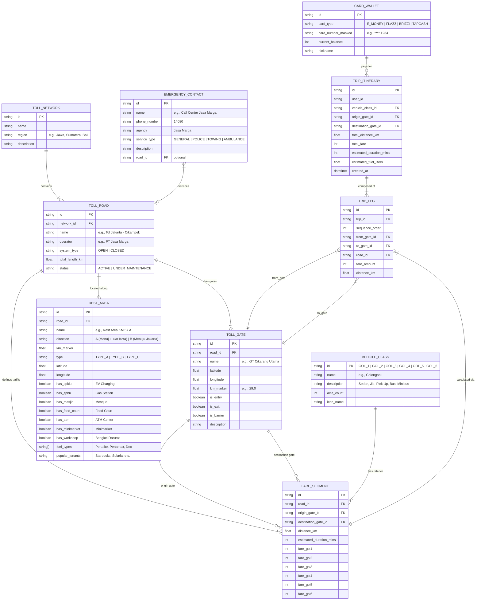

# Entity Relationship Diagram (ERD) & Data Architecture
## Project: Toll Helper (Aplikasi Asisten & Kalkulator Tarif Tol Indonesia)

**Version:** 1.0.0  
**Status:** Approved  

---

## 1. Visual Entity Relationship Diagram (Mermaid)

---

## 2. Data Dictionary & Field Specifications

### 2.1 Entity: `TOLL_NETWORK`
Represents high-level geographic toll highway corridors.
| Field | Type | Constraints | Description |
|---|---|---|---|
| `id` | VARCHAR(32) | PRIMARY KEY | Unique network identifier (`trans_java`, `jabodetabek`, `trans_sumatera`, `bali`) |
| `name` | VARCHAR(100) | NOT NULL | Display name (e.g., "Jalan Tol Trans-Jawa") |
| `region` | VARCHAR(50) | NOT NULL | Island or territory (Jawa, Sumatera, Bali) |
| `description`| TEXT | NULLABLE | Geographic bounds and corridor details |

---

### 2.2 Entity: `TOLL_ROAD`
Individual toll concessions or expressway stretches operated by toll road enterprises (BUJT).
| Field | Type | Constraints | Description |
|---|---|---|---|
| `id` | VARCHAR(64) | PRIMARY KEY | Identifier (`japek`, `cipali`, `jagorawi`, etc.) |
| `network_id` | VARCHAR(32) | FOREIGN KEY -> TOLL_NETWORK.id | Parent highway network |
| `name` | VARCHAR(150) | NOT NULL | Official section name |
| `operator` | VARCHAR(100) | NOT NULL | Concession operator (Jasa Marga, Astra Tol Cipali, etc.) |
| `system_type`| ENUM('OPEN', 'CLOSED') | NOT NULL | Flat rate at barrier (OPEN) or ticket-based barrier-to-barrier (CLOSED) |
| `total_length_km` | DECIMAL(6,2) | NOT NULL | Total length in kilometers |
| `status` | ENUM('ACTIVE', 'MAINTENANCE') | DEFAULT 'ACTIVE' | Operational status |

---

### 2.3 Entity: `TOLL_GATE`
Physical toll plazas, interchanges, and entry/exit on-ramps/off-ramps.
| Field | Type | Constraints | Description |
|---|---|---|---|
| `id` | VARCHAR(64) | PRIMARY KEY | Unique gate code (`gt_cikarang_utama`, `gt_kalikangkung`) |
| `road_id` | VARCHAR(64) | FOREIGN KEY -> TOLL_ROAD.id | Associated toll road |
| `name` | VARCHAR(150) | NOT NULL | Plaza name (e.g., "Gerbang Tol Cikampek Utama") |
| `latitude` | DECIMAL(10,7) | NOT NULL | GPS Latitude coordinate |
| `longitude` | DECIMAL(10,7) | NOT NULL | GPS Longitude coordinate |
| `km_marker` | DECIMAL(6,2) | NOT NULL | Chainage marker (e.g., KM 70.0) |
| `is_entry` | BOOLEAN | DEFAULT TRUE | Allows entrance to toll road |
| `is_exit` | BOOLEAN | DEFAULT TRUE | Allows exit from toll road |
| `is_barrier` | BOOLEAN | DEFAULT FALSE | Barrier toll gate where tariff is paid |

---

### 2.4 Entity: `FARE_SEGMENT`
Tariff matrix defining the rate between two gates for all vehicle classes.
| Field | Type | Constraints | Description |
|---|---|---|---|
| `id` | VARCHAR(64) | PRIMARY KEY | Segment identifier |
| `road_id` | VARCHAR(64) | FOREIGN KEY -> TOLL_ROAD.id | Toll road concession |
| `origin_gate_id` | VARCHAR(64) | FOREIGN KEY -> TOLL_GATE.id | Entrance plaza |
| `destination_gate_id` | VARCHAR(64) | FOREIGN KEY -> TOLL_GATE.id | Exit plaza |
| `distance_km` | DECIMAL(6,2) | NOT NULL | Distance in KM |
| `estimated_duration_mins`| INT | NOT NULL | Average driving time in minutes |
| `fare_gol1` | INT | NOT NULL | Fare for Golongan I (Sedan/Bus/Minibus) |
| `fare_gol2` | INT | NOT NULL | Fare for Golongan II (2-Axle Truck) |
| `fare_gol3` | INT | NOT NULL | Fare for Golongan III (3-Axle Truck) |
| `fare_gol4` | INT | NOT NULL | Fare for Golongan IV (4-Axle Truck) |
| `fare_gol5` | INT | NOT NULL | Fare for Golongan V (5+ Axle Truck) |
| `fare_gol6` | INT | DEFAULT 0 | Fare for Golongan VI (Motorcycle - Bali Mandara) |

---

### 2.5 Entity: `REST_AREA`
Service and rest areas along expressways.
| Field | Type | Constraints | Description |
|---|---|---|---|
| `id` | VARCHAR(64) | PRIMARY KEY | Unique rest area ID |
| `road_id` | VARCHAR(64) | FOREIGN KEY -> TOLL_ROAD.id | Associated toll road |
| `name` | VARCHAR(150) | NOT NULL | Name (e.g., "Rest Area KM 57 A Jakarta-Cikampek") |
| `direction` | VARCHAR(20) | NOT NULL | Traffic direction (A = Outbound, B = Inbound) |
| `km_marker` | DECIMAL(6,2) | NOT NULL | KM location marker |
| `type` | ENUM('TYPE_A', 'TYPE_B', 'TYPE_C') | NOT NULL | Classification based on facilities |
| `latitude` | DECIMAL(10,7) | NOT NULL | GPS Latitude |
| `longitude` | DECIMAL(10,7) | NOT NULL | GPS Longitude |
| `has_spklu` | BOOLEAN | DEFAULT FALSE | Electric Vehicle Fast Charger available |
| `has_spbu` | BOOLEAN | DEFAULT TRUE | Gas Station available |
| `has_masjid` | BOOLEAN | DEFAULT TRUE | Large Mosque / Prayer Room |
| `has_food_court`| BOOLEAN | DEFAULT TRUE | Restaurants and food court |
| `has_atm` | BOOLEAN | DEFAULT TRUE | Bank ATM gallery |
| `has_minimarket`| BOOLEAN | DEFAULT TRUE | 24-hour convenience store |
| `has_workshop` | BOOLEAN | DEFAULT FALSE | Emergency tire and mechanic shop |

---

### 2.6 Entity: `CARD_WALLET`
User's prepaid electronic money cards for tracking toll payment capability.
| Field | Type | Constraints | Description |
|---|---|---|---|
| `id` | VARCHAR(64) | PRIMARY KEY | Local card record ID |
| `card_type` | ENUM('E_MONEY', 'FLAZZ', 'BRIZZI', 'TAPCASH') | NOT NULL | Issuer brand |
| `card_number_masked`| VARCHAR(20) | NULLABLE | Last 4 digits for identification |
| `current_balance` | INT | NOT NULL DEFAULT 0 | Current stored balance (IDR) |
| `nickname` | VARCHAR(50) | NULLABLE | User custom label (e.g., "Kartu Utama Mobil") |

---

### 2.7 Entity: `EMERGENCY_CONTACT`
Direct emergency contacts for roadside assistance and rescue.
| Field | Type | Constraints | Description |
|---|---|---|---|
| `id` | VARCHAR(32) | PRIMARY KEY | ID |
| `name` | VARCHAR(100) | NOT NULL | Contact title |
| `phone_number` | VARCHAR(30) | NOT NULL | Dialable phone number (e.g. `14080`) |
| `agency` | VARCHAR(100) | NOT NULL | Entity / BUJT |
| `service_type` | ENUM('GENERAL', 'POLICE', 'TOWING', 'AMBULANCE') | NOT NULL | Service category |
| `description` | TEXT | NULLABLE | Details on services and free rescue range |
